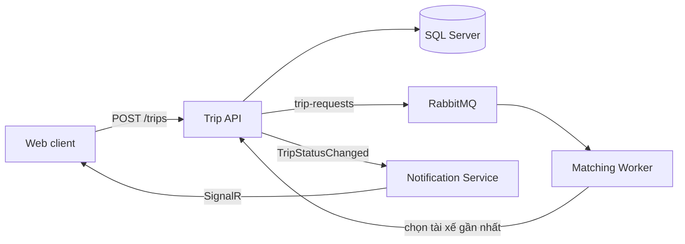

# Đi Chung — hệ thống đặt chuyến xe và phân phối tài xế

Dự án mẫu môn **Phát triển ứng dụng phân tán**, viết bằng C# / .NET 10 Minimal API. Giao diện web tiếng Việt cho phép tạo chuyến, xem lịch sử, theo dõi trạng thái trực tiếp và cập nhật các bước thực hiện chuyến.

## Chạy bằng Docker Compose

Cần Docker Desktop đang chạy. Từ thư mục gốc dự án:

```bash
docker compose up --build
```

Mở trang web tại [http://localhost:3000](http://localhost:3000). API chạy ở `http://localhost:8080`, SignalR ở `http://localhost:8081/hubs/trips`, và RabbitMQ Management ở [http://localhost:15672](http://localhost:15672) (tài khoản mặc định trong môi trường demo: `ride` / `ride_dev_2026`). SQL Server lưu dữ liệu trong volume `sql-data`.

Dừng các container: `docker compose down`. Muốn xóa cả dữ liệu demo: `docker compose down -v`.

Có thể thay mật khẩu demo khi khởi động bằng biến môi trường `MSSQL_SA_PASSWORD` và `RABBITMQ_PASSWORD`. Mật khẩu SQL cần đáp ứng chính sách của SQL Server. Các giá trị mặc định chỉ dành cho chạy thử trên máy cá nhân.

## Luồng xử lý



API ghi chuyến và message outbox trong cùng transaction. Outbox dispatcher gửi yêu cầu qua RabbitMQ và tự thử lại nếu broker tạm thời lỗi. Matching Worker lấy danh sách tài xế đang rảnh, chọn tài xế gần điểm đón nhất bằng khoảng cách Haversine, rồi yêu cầu API gán tài xế trong transaction. Sự kiện trạng thái cũng đi qua outbox tới Notification Service; service này gửi sự kiện tới các client SignalR đang theo dõi mã chuyến hoặc hành khách.

## API chính

| Phương thức | Đường dẫn | Mục đích |
|---|---|---|
| `POST` | `/trips` | Tạo yêu cầu chuyến xe |
| `GET` | `/trips/{id}` | Xem chi tiết chuyến |
| `GET` | `/users/{userId}/trips` | Lịch sử chuyến của hành khách |
| `PATCH` | `/trips/{id}/status` | Chuyển trạng thái chuyến |
| `GET` | `/drivers/available` | Danh sách tài xế rảnh |

Ví dụ tạo chuyến:

```json
{
  "passengerId": "khach-001",
  "pickup": "Nhà thờ Đức Bà",
  "destination": "Chợ Bến Thành",
  "pickupLatitude": 10.7798,
  "pickupLongitude": 106.699,
  "destinationLatitude": 10.772,
  "destinationLongitude": 106.698
}
```

Các trạng thái: `Requested` → `Matched` → `InProgress` → `Completed`; chuyến có thể chuyển sang `Cancelled` trước khi kết thúc. API kiểm tra các chuyển trạng thái hợp lệ. Tài khoản demo `khach-001` được điền sẵn trên trang web.

## Cấu trúc mã nguồn

- `src/Ride.Web`: giao diện web responsive, HTML/CSS/JavaScript.
- `src/Ride.Api`: API chuyến xe, dữ liệu SQL Server, publisher RabbitMQ.
- `src/Ride.MatchingWorker`: consumer queue và quy tắc phân phối tài xế.
- `src/Ride.Notifications`: SignalR Hub và phát trạng thái chuyến.
- `src/Ride.Contracts`: message dùng chung giữa các service.
- Mỗi service .NET có Dockerfile riêng; `docker-compose.yml` kết nối các service bằng tên service trên network nội bộ.

## Ghi chú demo

API tự tạo schema khi khởi động và khởi tạo ba tài xế mẫu nếu bảng tài xế đang trống. Đây là bản phục vụ học tập: chưa có đăng nhập/phân quyền, định vị GPS trực tiếp, bản đồ địa chỉ hoặc migration cho dữ liệu triển khai thực tế. Các route `/internal/*` chỉ nên truy cập bên trong mạng Docker.

## Báo cáo bài tập lớn

Xem [báo cáo thiết kế và đánh giá hệ thống](docs/BAO-CAO.md) để biết phân tích yêu cầu, kiến trúc, mô hình dữ liệu, luồng giao tiếp, API, triển khai và các kịch bản nghiệm thu.
