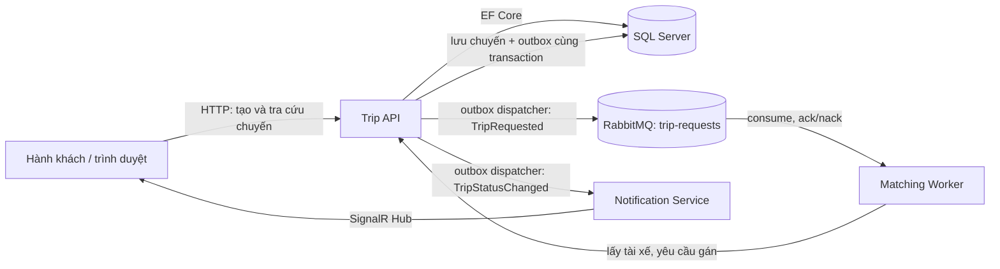
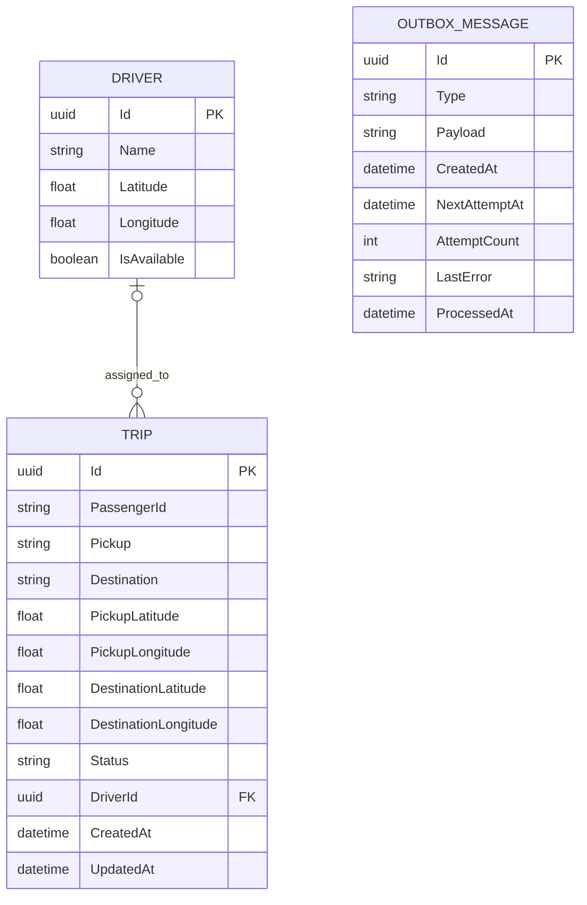
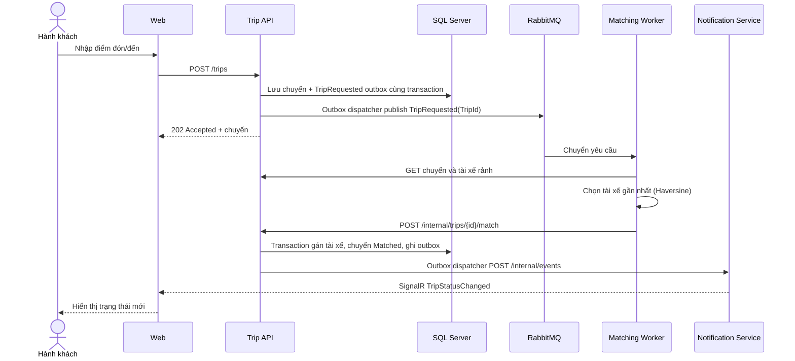
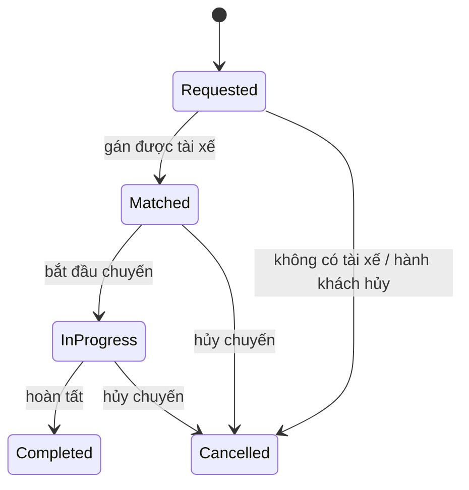

# Báo cáo bài tập lớn: Hệ thống đặt chuyến xe và phân phối tài xế

**Học phần:** Phát triển ứng dụng phân tán  
**Công nghệ:** C# / .NET 10 Minimal API, SQL Server, RabbitMQ, SignalR, Docker Compose  
**Tên hệ thống:** Đi Chung

## 1. Bài toán và mục tiêu

Hành khách gửi yêu cầu chuyến gồm điểm đón và điểm đến. Hệ thống lưu yêu cầu, đưa mã chuyến vào hàng đợi, tìm tài xế đang rảnh gần điểm đón nhất, gán tài xế và thông báo thay đổi trạng thái về trình duyệt. Ứng dụng minh họa cách chia một luồng nghiệp vụ thành API, worker xử lý nền, cơ sở dữ liệu quan hệ và dịch vụ thông báo.

Mục tiêu của bản mẫu:

- Cho phép tạo chuyến, tra cứu chi tiết và xem lịch sử theo hành khách.
- Ghép tài xế tự động từ danh sách sẵn sàng.
- Lưu chuyến, tài xế, tọa độ, thời gian và trạng thái trong SQL Server.
- Phát cập nhật gần thời gian thực bằng SignalR.
- Chạy toàn bộ các thành phần bằng Docker Compose, dùng cấu hình theo môi trường.

## 2. Phân tích yêu cầu

| Mã | Yêu cầu | Thành phần thực hiện |
|---|---|---|
| F1 | Tạo chuyến với điểm đón, điểm đến và tọa độ | Web, `POST /trips` |
| F2 | Đưa mã chuyến vào hàng đợi | Trip API, RabbitMQ `trip-requests` |
| F3 | Chọn một tài xế phù hợp, gần điểm đón nhất | Matching Worker |
| F4 | Theo dõi `Requested`, `Matched`, `InProgress`, `Completed`, `Cancelled` | Trip API, SQL Server |
| F5 | Lưu tài xế được gán trong chuyến | SQL Server, quan hệ Trip–Driver |
| F6 | Phát sự kiện khi trạng thái thay đổi | Trip API → Notification Service |
| F7 | Cập nhật trạng thái trên client theo thời gian thực | Notification Service, SignalR |
| F8 | Tra cứu chi tiết, lịch sử và tài xế đang rảnh | Trip API |
| T1 | Dùng C# và .NET 10 Minimal API | Các service .NET |
| T2 | Mỗi service có Dockerfile, khởi chạy qua Compose | `src/*/Dockerfile`, `docker-compose.yml` |
| T3 | Service trao đổi qua network bằng tên service | Compose network mặc định |
| T4 | Cấu hình phụ thuộc qua appsettings và biến môi trường | `appsettings.json`, Compose environment |
| T5 | Có log, phục hồi kết nối và gửi lại message tạm lỗi | Microsoft logging, Matching Worker reconnect loop, SQL outbox |

## 3. Kiến trúc tổng thể



Các service được tách thành project riêng:

| Service | Trách nhiệm | Cổng trong container |
|---|---|---:|
| `web` | Form đặt chuyến, danh sách lịch sử, thao tác trạng thái | 8080 |
| `api` | REST API, kiểm tra đầu vào, lưu dữ liệu, publish yêu cầu | 8080 |
| `matching-worker` | Tiêu thụ queue, xếp hạng tài xế, gọi API để gán | — |
| `notifications` | SignalR Hub, gửi sự kiện theo nhóm chuyến/hành khách | 8080 |
| `sql` | Lưu dữ liệu quan hệ | 1433 |
| `rabbitmq` | Hàng đợi bền vững `trip-requests` | 5672 |

Các cổng host mặc định: web `3000`, API `8080`, notifications `8081`, SQL Server `1433`, RabbitMQ `5672` và giao diện quản trị RabbitMQ `15672`.

## 4. Mô hình dữ liệu



Một tài xế có thể được gán cho nhiều chuyến ở các thời điểm khác nhau; tại một thời điểm chỉ được gán khi `IsAvailable = true`. Trường `DriverId` của chuyến cho phép null khi chưa ghép được tài xế. Bảng `OutboxMessages` lưu message cần gửi và lịch thử lại. Cơ sở dữ liệu được tạo khi API khởi động bằng `EnsureCreated`; nếu database demo cũ đã có sẵn thì API tạo bổ sung bảng outbox nếu thiếu. Ba tài xế mẫu được thêm nếu bảng tài xế đang rỗng.

## 5. Luồng nghiệp vụ



Worker xếp hạng tài xế theo công thức Haversine trên tọa độ điểm đón và tọa độ tài xế mẫu. Khi không còn tài xế rảnh, chuyến được chuyển `Cancelled` với thông điệp “No available driver was found”. Việc gán kiểm tra lại tài xế còn rảnh bên trong transaction để tránh hai worker cùng gán một tài xế.

Các chuyển trạng thái được chấp nhận:



Khi chuyến hoàn thành hoặc bị hủy sau khi đã có tài xế, tài xế được trả về trạng thái sẵn sàng.

## 6. API và message

### REST API cho client

| Method | Route | Nội dung |
|---|---|---|
| `POST` | `/trips` | Tạo chuyến, lưu DB và enqueue mã chuyến |
| `GET` | `/trips/{id}` | Lấy chi tiết chuyến; có thể lọc thêm `?passengerId=...` |
| `GET` | `/users/{userId}/trips` | Lịch sử chuyến của hành khách |
| `PATCH` | `/trips/{id}/status` | Chuyển sang `InProgress`, `Completed` hoặc `Cancelled` |
| `GET` | `/drivers/available` | Tài xế đang sẵn sàng |
| `GET` | `/health` | Kiểm tra API còn hoạt động |

Body `POST /trips`:

```json
{
  "passengerId": "khach-001",
  "pickup": "Nhà thờ Đức Bà",
  "destination": "Chợ Bến Thành",
  "pickupLatitude": 10.7798,
  "pickupLongitude": 106.699,
  "destinationLatitude": 10.772,
  "destinationLongitude": 106.698
}
```

Body `PATCH /trips/{id}/status`: `{"status":"InProgress"}`. API trả `409 Conflict` nếu chuyển trạng thái không hợp lệ, `404 Not Found` nếu không có chuyến và lỗi validation khi thiếu dữ liệu hoặc tọa độ ngoài phạm vi.

### Giao tiếp giữa service

- RabbitMQ message `TripRequested`: `{ "tripId": "<guid>" }`. Queue durable tên `trip-requests`.
- Worker gọi các route nội bộ `/internal/trips/{id}`, `/internal/drivers/available`, `/internal/trips/{id}/match` và `/internal/trips/{id}/unmatched`.
- Outbox dispatcher gửi `TripStatusChanged` tới `/internal/events` của Notification Service. Message gồm `TripId`, `PassengerId`, `Status`, `DriverId`, `DriverName`, `ChangedAt` và `Message`.
- SignalR Hub `/hubs/trips` có method `JoinTrip(tripId)` và `JoinPassenger(passengerId)`. Event gửi tên `TripStatusChanged`.

## 7. Cấu hình và chạy lại hệ thống

Cấu hình mặc định nằm trong appsettings của từng service. Docker Compose ghi đè chuỗi kết nối SQL Server, RabbitMQ URI và địa chỉ Notification Service bằng biến môi trường; Compose DNS dùng tên `sql`, `rabbitmq`, `api`, `notifications` và `web`.

```bash
docker compose up --build
```

Mở `http://localhost:3000`, dùng hành khách demo `khach-001`, tạo chuyến và xem trạng thái. Có thể bắt đầu, hoàn tất hoặc hủy chuyến ngay trên trang. RabbitMQ Management ở `http://localhost:15672`. Dừng bằng `docker compose down`; lệnh `docker compose down -v` xóa luôn dữ liệu SQL demo.

Mỗi project .NET có Dockerfile riêng. Docker Compose chờ SQL Server, RabbitMQ, API và Notification Service đạt trạng thái health trước khi khởi động các service phụ thuộc.

## 8. Logging, phục hồi và giới hạn

Các service ghi log hoạt động chính: tạo chuyến, publish/consume queue, ghép hoặc không ghép được tài xế, cập nhật trạng thái và lỗi gửi thông báo. Trip API ghi message vào bảng outbox cùng transaction với thay đổi chuyến; dispatcher gửi lại khi RabbitMQ hoặc Notification Service tạm thời không sẵn sàng, dùng backoff tối đa 60 giây. API đợi publisher confirmation và gửi message persistent tới durable queue. Worker theo dõi trạng thái kết nối, reconnect sau lỗi; message xử lý lỗi được nack/requeue sau khoảng chờ ngắn. SQL Server volume và durable queue giữ dữ liệu qua vòng đời container.

Giới hạn của bản mẫu cần nêu khi trình bày:

- Chưa có xác thực người dùng; `passengerId` là mã demo do client gửi.
- Các route `/internal/*` dự kiến chỉ dùng trên mạng Docker; chưa có API key/mTLS.
- Tài xế là dữ liệu mẫu, chưa có ứng dụng tài xế hoặc GPS trực tiếp.
- Địa chỉ và tọa độ do client nhập; chưa tích hợp geocoding/bản đồ.
- Dùng `EnsureCreated` cho demo, chưa có migration để nâng cấp schema khi triển khai lâu dài.
- Outbox và publisher confirmation cung cấp cơ chế giao ít nhất một lần; service có thể nhận message lặp nếu tiến trình dừng sau khi broker xác nhận nhưng trước khi đánh dấu outbox hoàn tất. Matching Worker bỏ qua yêu cầu chuyến đã xử lý; event SignalR lặp có thể làm client tải lại danh sách.
- Bản demo chưa có chính sách dọn các bản ghi outbox đã xử lý.

## 9. Kịch bản nghiệm thu đề xuất

Các kịch bản này là checklist để chạy khi có môi trường Docker và khả năng tải package; chúng không được đánh dấu là đã chạy trong môi trường hiện tại.

1. Khởi chạy `docker compose up --build`; xác nhận web, API, broker và database đều healthy.
2. Tạo chuyến với body mẫu; xác nhận API trả `202` và chuyến bắt đầu ở `Requested`.
3. Chờ worker xử lý; xác nhận chuyến thành `Matched`, có `DriverId`, và tài xế đó không còn trong `/drivers/available`.
4. Mở trình duyệt theo dõi hành khách `khach-001`; xác nhận SignalR cập nhật sau khi chuyến được ghép.
5. Gửi `PATCH` chuyển sang `InProgress`, sau đó `Completed`; xác nhận lịch sử hiển thị trạng thái và tài xế được trả về danh sách rảnh.
6. Thử chuyển thẳng `Requested` sang `Completed`; xác nhận API từ chối với `409`.
7. Tạo chuyến khác khi hết tài xế; xác nhận chuyến bị hủy kèm lý do không có tài xế.
8. Khởi động lại API/container; xác nhận dữ liệu chuyến vẫn còn trong volume SQL.

**Kiểm tra đã thực hiện trong môi trường tạo dự án:** `docker compose config -q` thành công. Chưa xác nhận build hoặc chạy tích hợp toàn bộ: NuGet restore không tải được EF Core/RabbitMQ do môi trường chặn kết nối tới `api.nuget.org`.

## 10. Kết luận

Hệ thống hiện thực luồng phân tán chính của đề tài: HTTP nhận yêu cầu, SQL Server lưu trạng thái, RabbitMQ tách xử lý ghép tài xế khỏi request, worker tìm tài xế gần nhất và SignalR đẩy trạng thái về web client. Các giới hạn và checklist ở trên phân biệt rõ phần đã triển khai với phần cần kiểm chứng hoặc mở rộng trước khi dùng ngoài môi trường học tập.
